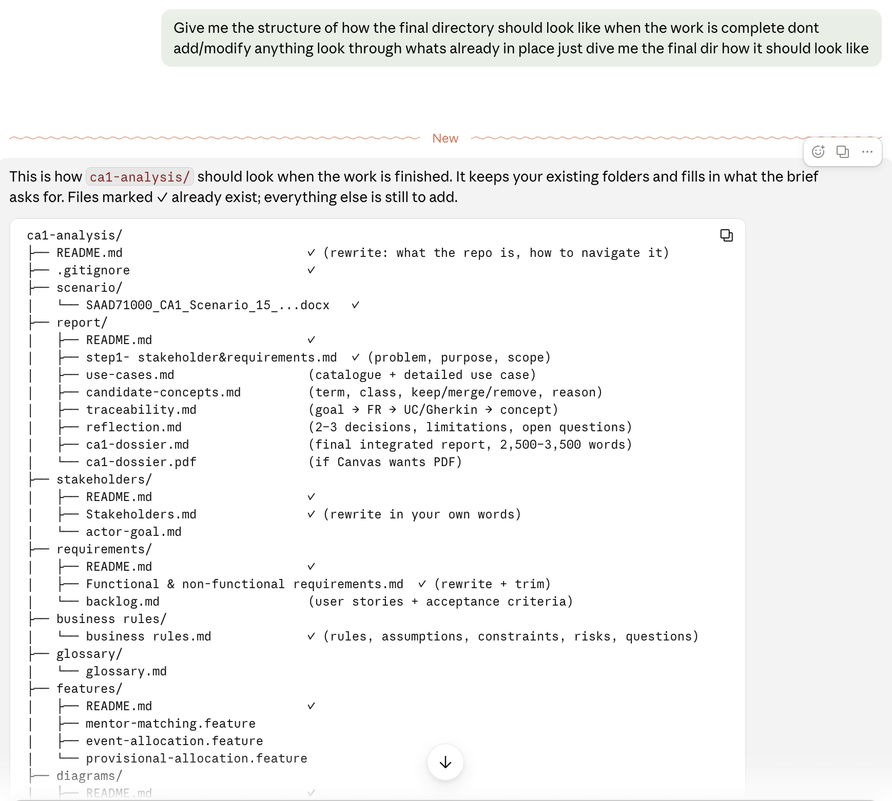
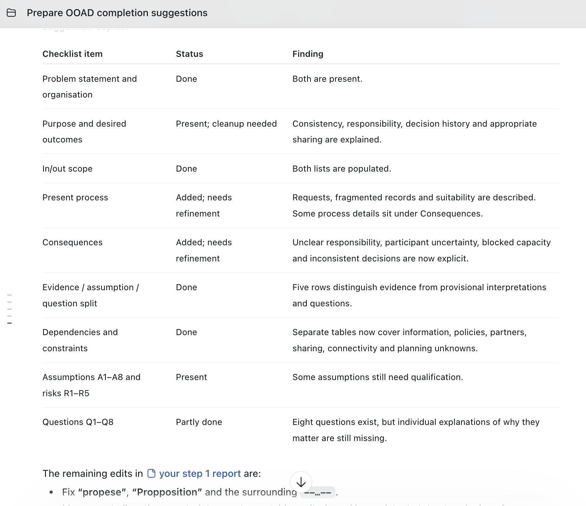
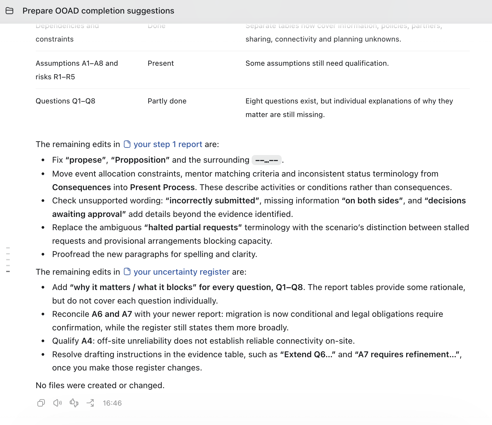
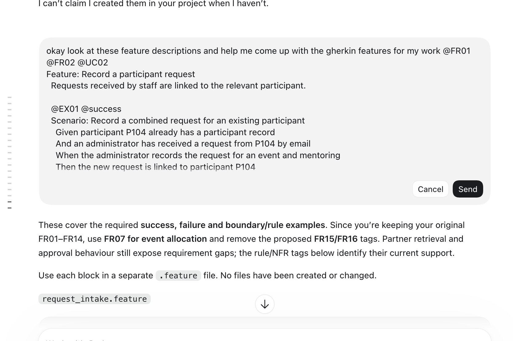
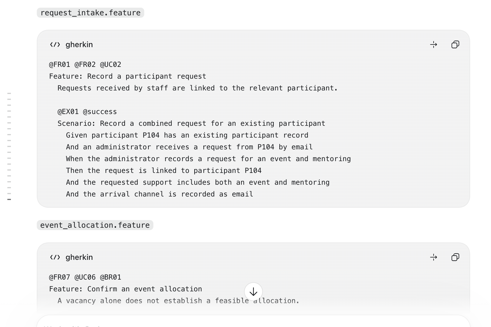
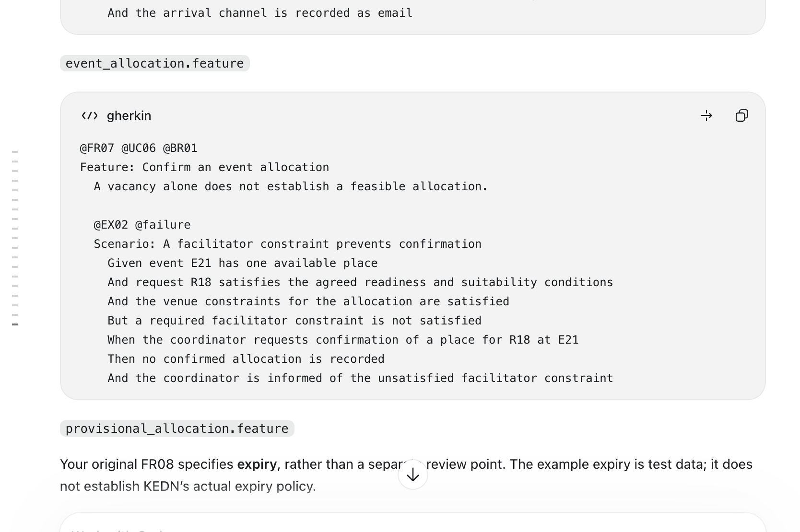
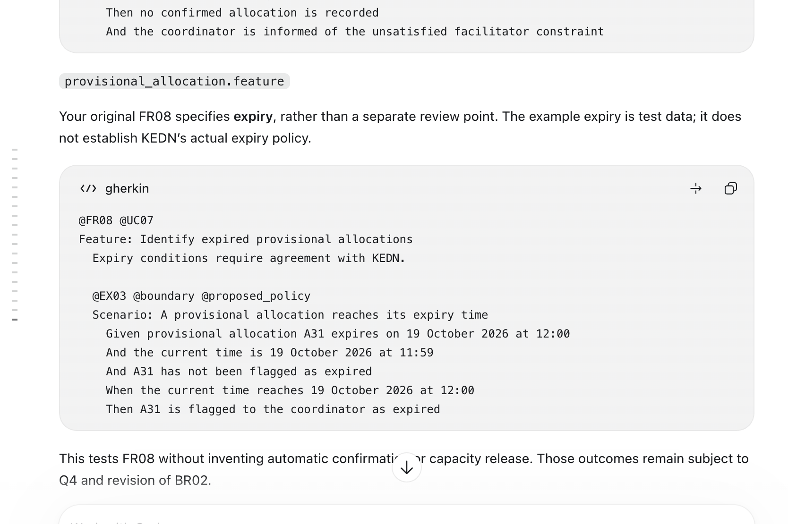
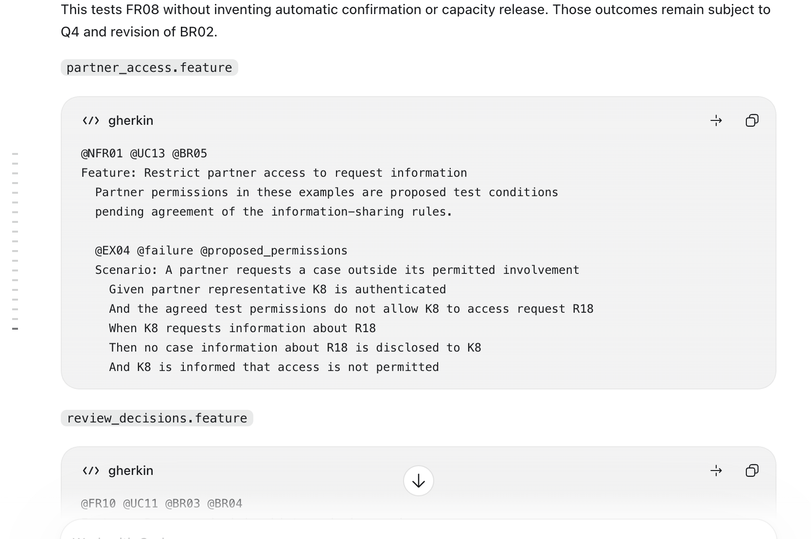
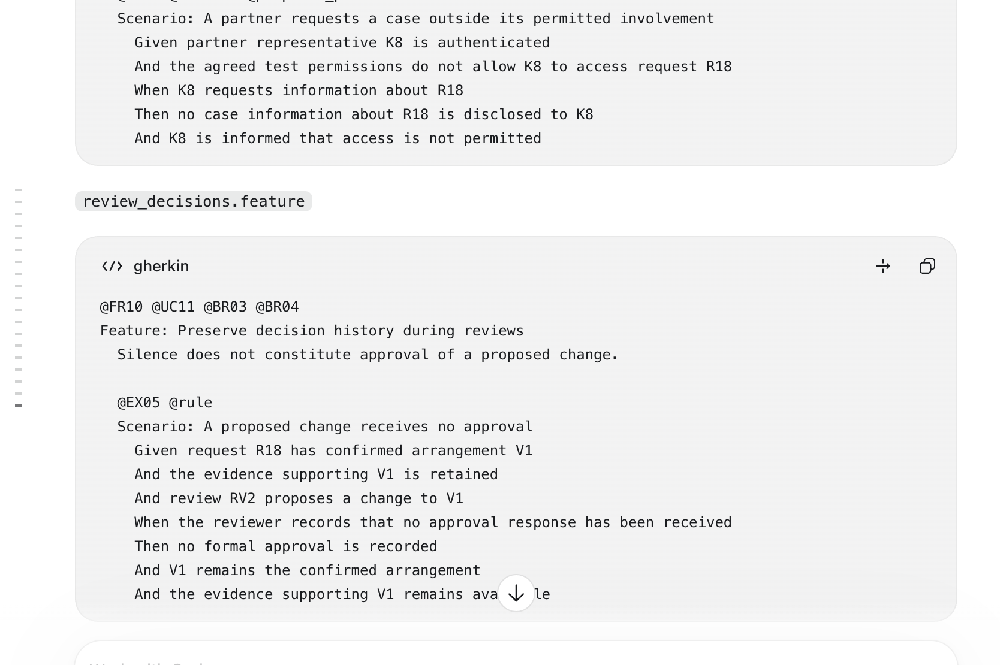

# This is a log for actions where ai was involved.

**Ai tools used**
- Claude
- ChatGPT

***I asked claude to look through my work and guide me on how to structure my work according to the rubric. I then moved to Codex becuase the respnses from claude were more buzzwords and fluff rather than actual guidance.***

***I also asked claude to generate for me a working plan based off the scenario, the rubric and the downloaded notes so i would have a good basis to work with***

Response Screenshot: 

**Ai suugestion that came up when working** 
- "Distinguishing changes from decisions (worth adding to FR10 or as its own requirement): the scenario says staff must "distinguish an operational change from a formal decision and avoid treating silence as approval". This maps directly to business rule BR04 below".

***Ai helped with completing my tables in step1-stakeholders & requirements for dependencies and constraints.***

***Asked ai to grade my work done in step1-stakeholders and requirements screnshot attached***

***Ai later helped me refine and deep dive into my use-cases.md giving more in depth explanations and proposing questions***

**Ai suugested that i change up my Funtional Requirements registry and gave multiple reasons some good some semi vague it gave responses like 

| Suggested change | Why I suggested it | What keeping your current version means |
|---|---|---|
| Combine FR03 and FR04 | Stage and waiting reason jointly describe request progress; combining reduces the count. | Keeping them separate is reasonable and more atomic. |

Ai proposed multiple of these ammendments as we worked .This was later rejected

Ai helped me come up with my generation for the features in gherkin 

***After going through the rubric i realised "Clarification questions" were a big point of action in the Ai suggestions that werent included in the lecture notes so i spent some time rubbing those out of my work and explicitly told Ai not to suggest points with clarification questions. Ai had kept on suggesting leaving in open ended questions as i worked throught the project but after logically thinking about it, since there is no actual business to see and talk to, the assumptive questions weren't needed as previously thought.The questions were mainly of the tone: "This needs clarification, pending clarification depending on this clarifcation... after a major re-word i eventually cut them from the project."***

Ai helped generate a use case diagram from my use cases

Ai helped generate a domain model from my domain analysis