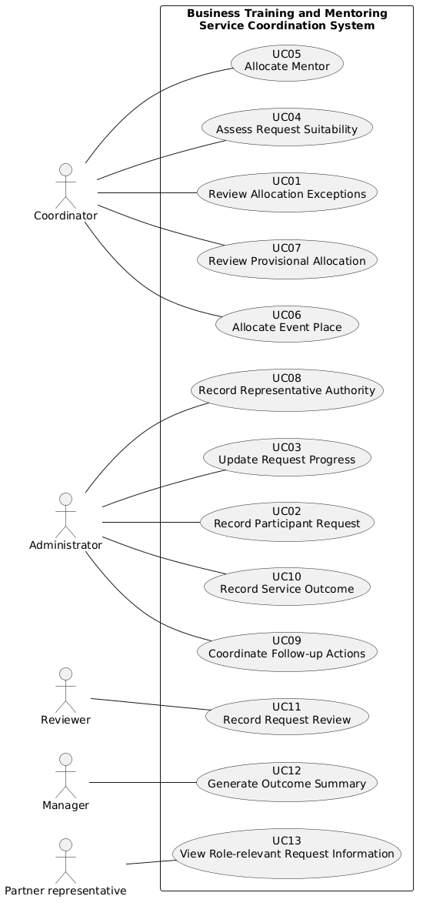
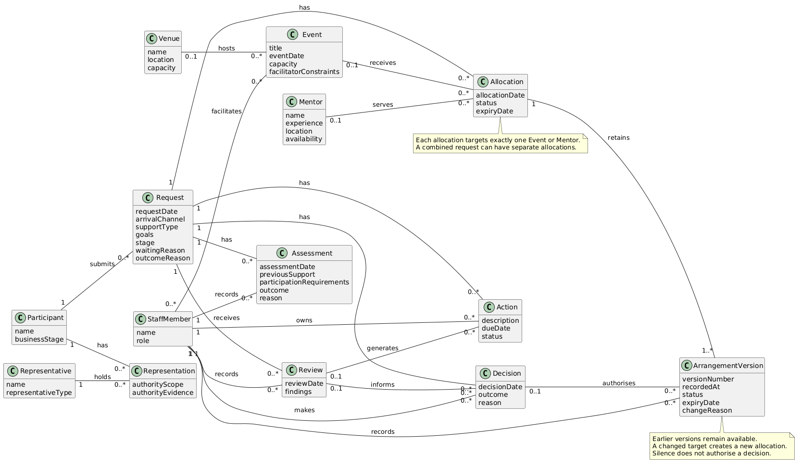

# CA1: Requirements and Domain Analysis - KEDN

## Student and Repository Details
```text
Elisha Seruma: T00228778

GitHub Repo: https://github.com/ElishaSeruma/ca1-analysis
```
## 1. Problem, Purpose, Scope and Uncertainty

### 1.1 Organisation and Present Process

Kerry Enterprise Development Network (KEDN) provides short courses, workshops and one-to-one mentoring for new and growing businesses. Participants can request an event, mentoring or both. Requests arrive through several channels and may be incomplete.

Staff distinguish initial interest, requests awaiting evidence and requests ready for a decision. Suitability depends on business stage, goals, previous support and practical participation requirements. Event allocations depend on capacity, venue and facilitator constraints. Mentor matching considers experience, conflicts of interest, location, availability and participant goals.

Registrations, schedules, availability, progress and actions are held across spreadsheets, forms, email, messages and notes. Reviews can produce revised arrangements, further actions or escalation. This is an interpreted service lifecycle, not a confirmed standard sequence.

### 1.2 Business Problem and Consequences

KEDN lacks a consistent way to coordinate requests and their supporting information. Different teams use status terms differently. Staff cannot always identify what awaits action or who is responsible. Participants need to know whether they await information, a decision or an outside organisation.

Stalled provisional arrangements can continue blocking capacity. Inconsistent priorities and exceptions make decisions harder to apply and explain. Fragmented records also create risks of missed actions, unsuitable allocations, lost decision evidence and inappropriate disclosure. These risks are not evidence that such incidents have already occurred. The scenario provides no measured delay, loss or incident figures.

### 1.3 Purpose and Desired Outcomes

The proposed Business Training and Mentoring Service Coordination System supports consistent, traceable coordination from initial interest through assessment, allocation, delivery, review and closure.

The intended outcomes are clear request positions, visible action ownership, feasible allocations and retained decision history. Provisional arrangements remain distinguishable from confirmed ones. Information is shared according to role needs. Management and funders receive appropriate summaries without unnecessary personal or commercially sensitive detail.

### 1.4 In-Scope and Out-of-Scope Functions

**In scope:**

- Participant and request records, including received and missing evidence.
- Request progress, suitability assessments and reasons.
- Mentor matching and event allocation against applicable constraints.
- Provisional status and expiry information.
- Actions, owners, due dates, reviews and retained decision history.
- Changes, pauses, withdrawals and incomplete-outcome reasons.
- Representative authority records, appropriate sharing and summary reporting.
- Coordinator exception information and off-site record-keeping needs.

Direct partner retrieval remains conditional under UC13. Staff-mediated sharing is the current proposed arrangement. UC07 covers inspection of provisional information; recording its review outcome and releasing capacity are deferred.

**Out of scope:** specialist professional systems, financial accounting and unrelated public website functions. Course-content delivery and marketing are additional assumed exclusions under A5.

### 1.5 Dependencies and Constraints

Coordination depends on current mentor, event, venue and facilitator information. It also depends on KEDN's rules for readiness, eligibility, priority, representative authority, approvals and information sharing. Some requests depend on outside organisations; their response times and system integrations are not established.

Off-site connectivity may be unreliable. Sharing must be limited to relevant information. Applicable data-protection and retention obligations remain unconfirmed. Historical-data migration is conditional on KEDN needing existing records in the proposed system. Workload, budget and implementation resources are not stated and cannot support fixed planning claims.

### 1.6 Scenario Evidence and Assumptions

Evidence and interpretation are kept separate. The [uncertainty register](<../business rules/business rules.md>) holds A1-A8 and the related questions.

| Scenario evidence | Assumption or interpretation | Related question |
|---|---|---|
| Requests may cover events, mentoring or both and may be incomplete. | A2 proposes a shared stage model. Identical transitions are not confirmed. | Q1: readiness requirements. |
| Teams use different status terms and responsibility can be unclear. | A3 proposes one responsible coordinator per request. Individual action ownership remains distinct. | Q6: relationships and responsibility. |
| Provisional arrangements can block capacity. | Expiry handling is proposed; automatic release is not established. | Q4: expiry, confirmation and release. |
| Another person or organisation may assist a participant. | Assistance alone does not establish authority to receive information or approve decisions. | Q3: representative authority. |
| Partners require role-relevant information. | A7 leaves legal obligations, retention and detailed permissions unconfirmed. | Q7: sharing and retention. |

A1 allows several requests per participant. A4 does not assume reliable on-site connectivity. A6 makes migration conditional. A8 marks numerical quality targets as provisional rather than scenario facts.

### 1.7 Risks and Clarification Questions

| Risk | Description |
|---|---|
| R1 | Stalled provisional arrangements continue blocking capacity. |
| R2 | Inappropriate sharing exposes personal or commercially sensitive information. |
| R3 | Unresolved policies are treated as confirmed rules. |
| R4 | Parallel spreadsheets and system records diverge. |
| R5 | Offline edits conflict during synchronisation. |


| Question | Information needed | Why it matters |
|---|---|---|
| Q1 | Evidence required before a request is ready for decision. | Defines completeness and progression checks. |
| Q2 | Eligibility, priority, exception rules and responsible roles. | Supports consistent assessment. |
| Q3 | Authority required when another person acts for a participant. | Defines permitted assistance and disclosure. |
| Q4 | Provisional expiry, confirmation and release authority. | Defines capacity handling without assuming automatic release. |
| Q5 | Approval authority for changes, substitutions and withdrawal. | Separates operational updates from formal decisions. |
| Q6 | Links between versions, reviews, actions and responsible staff. | Preserves history and makes pending work clear. |
| Q7 | Role-based sharing, retention and disposal obligations. | Defines information boundaries and retention handling. |
| Q8 | Typical request, event and mentor volumes. | Supports workload and feasibility estimates. |

## 2. Stakeholders, Actors and Goals

### 2.1 Stakeholder Catalogue: Goals, Concerns and Influence

The catalogue covers service users, staff and external interests. Direct involvement in the service does not necessarily mean direct software access. Influence ratings are analysis judgements. SH11 is unconfirmed; SH12 is assumed from venue constraints.

| ID | Stakeholder | Type | Goal | Concern / evidence | Influence |
|---|---|---|---|---|---|
| SH01 | Coordinator | Direct | Make sound matches and allocations; see exceptions | "A vacancy is not a match unless all of the important requirements are satisfied." | High |
| SH02 | Administrator | Direct | Keep records complete; free up stalled capacity | "Provisional arrangements can block capacity long after the original request has stalled." | Medium |
| SH03 | Service user / participant | Direct | Know where their request stands and what it waits on | "I need to know whether I am waiting for information, a decision or an outside organisation." | Medium |
| SH04 | Mentor | Direct | Receive suitable matches; declare conflicts and availability | Scenario: matching considers "experience, conflicts of interest, location, availability" | Medium |
| SH05 | Facilitator | Direct | Know event bookings and requirements | Scenario: events have "facilitator constraints" | Low |
| SH06 | Reviewer | Direct | Add new evidence without losing the earlier basis | "New information should be added without erasing the basis of the earlier decision." | Medium |
| SH07 | Manager | Indirect | Consistent outcome reasons; reporting | "We need consistent reasons for delay, withdrawal and incomplete outcomes." | High |
| SH08 | Partner representative | External | Only the information their role needs | "I need the information required for my role, not the complete case history." | Medium |
| SH09 | Funder | External (offstage) | Summary outcomes without personal data | Scenario: "Summary reporting for management and funders" | High (funding) |
| SH10 | Representative / assistant acting for a participant | External | Act on the participant's behalf | Scenario: "Another person or organisation may assist with a request" | Low |
| SH11 | Data protection officer / regulator | Candidate offstage stakeholders; roles unconfirmed | Lawful, minimal sharing of personal data | Neither role is named in the scenario. Information-sharing concerns suggest checking the responsible roles; A7/Q7 leave obligations subject to confirmation. | Potentially high; role and authority unconfirmed |
| SH12 | Venue provider | Assumed external/offstage stakeholder | Bookings that respect venue capacity | Venue constraints are explicit in the scenario; a separate provider role and its interactions are not confirmed. | Low (proposed) |

### 2.2 System Boundary, Primary Actors, Supporting Actors and Offstage Stakeholders

The boundary is the Business Training and Mentoring Service Coordination System. Coordinator, Administrator, Reviewer and Manager are proposed primary actors. They seek goals through the software. Participants, mentors, facilitators and participant representatives communicate through staff. Funders receive summaries through staff.

No supporting actor is established. Contributing to KEDN's business process alone does not make a role a supporting software actor. SH11 and SH12 remain candidate or assumed offstage stakeholders. Partner access is conditional under UC13. Its appearance in the diagram shows the candidate interaction, not an approved access policy.

### 2.3 Actor-Goal Catalogue

| Actor | Goal | Related use cases |
|---|---|---|
| Coordinator / SH01 | Identify exceptions, assess suitability, allocate support and inspect provisional arrangements. | UC01, UC04-UC07 |
| Administrator / SH02 | Record requests, progress, representative authority, actions and outcomes. | UC02, UC03, UC08-UC10 |
| Reviewer / SH06 | Record new findings without removing earlier decision evidence. | UC11 |
| Manager / SH07 | Obtain appropriate outcome summaries. | UC12 |
| Partner representative / SH08 | Obtain role-relevant request information if direct access is adopted. | UC13, conditional |

The [actor-goal catalogue](../stakeholders/actor-goal.md) records each individual goal and its requirement links. UC07 ends at inspection; review recording and capacity release are not implied.

## 3. Requirements and Business Rules

### 3.1 Functional Requirements

The catalogue gives each capability a stable ID, source, priority and verification method. Stages in FR03 are proposed vocabulary, not confirmed transitions. The standard list in FR11 remains a proposed way to achieve consistent outcome reasons.

| ID | Requirement | Source | MoSCoW | Verification |
|---|---|---|---|---|
| FR01 | The system shall maintain a single record per participant, linked to all of their requests. | Scenario: separate spreadsheets/forms; problem statement | Must | Test: create two requests for one participant; both appear under one record |
| FR02 | The system shall record a request for an event, mentoring or both, with the channel it arrived through. | "A participant may request an event, mentoring or both"; "several channels" | Must | Gherkin scenario |
| FR03 | The system shall classify each request into exactly one defined stage (for example Expression of interest, Awaiting evidence, Ready for decision, Provisionally allocated, Confirmed, In delivery, Paused, Withdrawn, Closed). | "distinguish an initial expression of interest, a request awaiting evidence and a request ready for a decision"; SH03 | Must | Inspection of the stage list; test of the stage transitions |
| FR04 | The system shall record, for a request that is waiting, whether it waits on information, a decision or an outside organisation. | SH03 quote | Must | Gherkin scenario |
| FR05 | The system shall record a suitability assessment against business stage, goals, previous support and participation requirements, with a reason. | "Suitability depends on…" | Must | Test |
| FR06 | The system shall allow a mentor match to be confirmed only when experience, conflict of interest, location, availability and goals have each been checked. | SH01 quote; matching criteria | Must | Gherkin (rule/boundary scenario) |
| FR07 | The system shall prevent an event allocation from being confirmed where capacity, venue or facilitator constraints are not satisfied. | "A visible vacancy does not necessarily mean…" | Must | Gherkin (failure scenario) |
| FR08 | The system shall record a provisional allocation with an expiry date and flag it to the coordinator once expired. | SH02 quote; "Provisional allocations sometimes remain…" | Must | Test with a date past expiry |
| FR09 | The system shall record each action with an owner, a due date and a status. | "difficult to identify … who is responsible" | Must | Test |
| FR10 | The system shall preserve earlier versions of an arrangement and the basis of each decision when a change or review occurs. | SH06 quote; "preserve the current confirmed position while retaining evidence" | Must | Test: amend, then view the history |
| FR11 | The system shall record withdrawal, delay and incomplete outcomes using a reason from a standard list. | SH07 quote | Could | Inspection plus test |
| FR12 | The system shall record a person or organisation acting for a participant, and the authority they hold. | "Another person or organisation may assist…" | Could | Test (depends on Q3) |
| FR13 | The system shall show the coordinator unallocated requests, provisional arrangements, capacity conflicts, overdue actions and incomplete records. | Coordinator information needs paragraph | Must | Demonstration |
| FR14 | The system shall produce summary reports for management and funders that exclude personal identifiers. | "Summary reporting … without exposing…" | Should | Inspection of a sample report |

### 3.2 Non-Functional Requirements

The quality requirements cover disclosure, reporting, interrupted connectivity, auditability, usability and retention. A8 marks numerical targets as provisional. Q7 supplies detailed permissions and retention rules. An acceptance target is not evidence that the system already meets it.

| ID | Category | Requirement (measurable) | Source | MoSCoW | Verification |
|---|---|---|---|---|---|
| NFR01 | Security / privacy | Partner users shall be able to view only the fields defined for their role; 100% of a sample of partner views shall contain no full case history. | SH08 quote | Must | Role-based access test |
| NFR02 | Privacy | Funder reports shall contain no personal identifiers, and any group with fewer than 5 participants shall be suppressed. | Funder reporting statement | Must | Report inspection (the threshold of 5 is Assumption A8) |
| NFR03 | Availability (offline) | Staff shall be able to record progress offline, and offline entries shall synchronise within 5 minutes of reconnection with no data loss. | "Connectivity may be unreliable" | Should | Simulated disconnection test |
| NFR04 | Auditability | 100% of stage changes and decisions shall record who made them, when, and the reason; audit records shall not be editable. | SH06 and SH07 quotes | Must | Audit log inspection |
| NFR05 | Usability | A participant or staff member shall be able to identify a request's current stage and what it waits on within 2 interactions/30 seconds. | SH03 quote | Should | Usability test with 5 users |
| NFR06 | Retention / compliance | Personal records shall have a retention category and due date under the agreed policy. Records due for disposal shall be deleted or anonymised unless an authorised hold applies. Policy periods and disposal deadlines remain subject to Q7. | A7; retention policy under Q7 | Must | Test records before and at disposal dates, with and without a hold; deadlines depend on Q7 |

### 3.3 Business Rules

The revised rule table is authoritative. The earlier version remains historical in the working register. The revised rules avoid treating expiry as automatic release or every conflict as an unconditional prohibition.

| ID | Revised rule | Evidence / status |
|---|---|---|
| BR01 | An allocation is suitable only when all applicable essential requirements are satisfied; a vacancy alone is insufficient. | Supported by Allocation and coordination and Coordinator statement; essential criteria/exception policy require Q2. |
| BR02 | A provisional allocation remains distinct from a confirmed arrangement. Its review/expiry point and permitted review outcomes must follow an agreed policy; reaching that point does not itself imply confirmation or automatic release. | Provisional arrangements and blocked capacity are evidenced. Review mechanism is proposed under Q4; duration, extensions, release authority and capacity effects are unconfirmed. |
| BR03 | A change or review must preserve the basis of earlier decisions and arrangements. | Supported by Allocation and coordination and Reviewer statement. Version relationships remain Q6. |
| BR04 | Silence or non-response is not approval. An operational update is not a formal decision unless explicit approval by an authorised role has been recorded. | The distinction and prohibition on silence as approval are explicit; precise approval record and role matrix require Q5. |
| BR05 | Partners receive only information necessary for their role. | Explicit scenario restriction. Actual fields, involvement/access conditions and permissions remain Q7. |
| BR06 | Conflicts of interest must be considered when assessing a mentor match; whether a conflict prohibits matching or permits an authorised exception requires agreement. | The scenario lists conflicts as a factor, not an absolute bar. Any stricter prohibition depends on Q2. |
| BR07 | Reasons for delay, withdrawal and incomplete outcomes must be recorded consistently. | The manager explicitly needs consistent reasons. Requiring a reason for every such record is a proposed operationalisation; a mandatory standard list and its categories are not confirmed. |

### 3.4 MoSCoW Priorities and Rationale

Must requirements establish the basic coordination chain. FR01-FR10 cover request capture, progress, assessment, feasible allocation, actions and history. FR13 makes unresolved coordination work visible. These support KEDN's stated operational problems.

FR11 and FR12 are Could in the current catalogue. Their dedicated recording functions can be deferred only with controlled manual records for outcome reasons and representative authority. The underlying need for appropriate authority and consistent reasons remains. FR14 is Should because checked summaries could be compiled manually as a temporary measure. These workaround choices are analysis judgements, not established KEDN procedures.

Privacy and audit NFRs are Must when the related functions are delivered. Offline convenience and usability are Should. The agreed scope still needs to support appropriate information handling throughout.

### 3.5 Verification Methods

Verification uses record inspection, role-access checks, timed usability tasks and concrete Gherkin examples. EX01-EX05 exist as specification files. They have no implemented step definitions and have not been executed against software. Other checks in the catalogue are planned verification, not completed test results.

### 3.6 Selected User Stories and Acceptance Criteria

The [backlog](../requirements/backlog.md) holds six stories. Each identifies stakeholder value, priority, requirement/rule links and observable acceptance conditions. Stories supplement the formal catalogue rather than replace it.

| Story | Goal and value | Acceptance focus | Links |
|---|---|---|---|
| ST01 | Record a received request so staff share its participant context. | Participant link, support type and arrival channel. | FR01/FR02; UC02; EX01 |
| ST02 | Record progress so staff can explain the next dependency. | Stage, waiting reason and permitted progression. | FR03/FR04; UC03 |
| ST03 | Confirm a feasible event place. | Capacity, venue/facilitator constraints and explicit confirmation. | FR07; FR08 for provisional alternative; UC06; EX02 |
| ST04 | Inspect provisional arrangements needing follow-up. | Visible status/expiry and expiry flag; no automatic release. | FR08/FR13; UC07; EX03 |
| ST05 | Obtain permitted partner information. | Restricted fields and denied unauthorised access. Deferred with direct partner access. | NFR01/BR05; UC13; EX04 |
| ST06 | Preserve the distinction between proposals and decisions. | Earlier evidence retained; silence is not approval. | FR10/BR03/BR04; UC11; EX05 |

## 4. Use Cases and Behavioural Examples

### 4.1 Use-Case Catalogue

Use cases describe actor goals within the shared boundary. The brief descriptions in [use-cases.md](use-cases.md) give triggers and outcomes. UC07 is limited to viewing supported provisional information. UC13 remains conditional because its retrieval function is not specified by an FR.

| ID | Use case | Primary actor | Requirement links | Status |
|---|---|---|---|---|
| UC01 | Review Allocation Exceptions | Coordinator | FR13 | Proposed; policy/access validation required |
| UC02 | Record Participant Request | Administrator | FR01, FR02 | Proposed; policy/access validation required |
| UC03 | Update Request Progress | Administrator | FR03, FR04 | Proposed; policy/access validation required |
| UC04 | Assess Request Suitability | Coordinator | FR05 | Proposed; policy/access validation required |
| UC05 | Allocate Mentor | Coordinator | FR06; FR08 for a provisional arrangement | Proposed; policy/access validation required |
| UC06 | Allocate Event Place | Coordinator | FR07; FR08 for a provisional arrangement | Proposed; policy/access validation required |
| UC07 | Review Provisional Allocation | Coordinator | FR08, FR13 | Limited to viewing provisional/expiry information and flags; disposition deferred under Q4 |
| UC08 | Record Representative Authority | Administrator | FR12 | Proposed; policy/access validation required |
| UC09 | Coordinate Follow-up Actions | Administrator | FR09 | Proposed; policy/access validation required |
| UC10 | Record Service Outcome | Administrator | FR11; FR03 for applicable stage changes | Proposed; policy/access validation required |
| UC11 | Record Request Review | Reviewer | FR10, FR09 | Proposed; policy/access validation required |
| UC12 | Generate Outcome Summary | Manager | FR14; NFR02 constrains content | Proposed; policy/access validation required |
| UC13 | View Role-relevant Request Information | Partner representative (conditional) | NFR01 constrains access; functional retrieval capability not specified | Deferred candidate; direct access and functional scope require agreement |

### 4.2 Use-Case Diagram



The diagram shows actors outside the named boundary and use cases inside it. Associations show participation, not workflow order. The [PlantUML source](../diagrams/use-case-model.puml) remains editable. UC13 is an unlabelled candidate in the image; its conditional scope is recorded above.

### 4.3 Detailed Use Case: Allocate Event Place

#### Scope, Level, Actors and Stakeholder Interests

**ID:** UC06. **Scope:** Business Training and Mentoring Service Coordination System. **Level:** user goal. **Primary actor:** Coordinator. No supporting actor is established for this interaction.

The participant needs a feasible place. The coordinator needs valid allocation information. The administrator needs a reliable capacity position. Facilitator and venue constraints must be respected. FR07 supports the main confirmation checks; FR08 supports the provisional alternative.

#### Preconditions and Trigger

**Preconditions:** The coordinator is permitted to perform allocation work. A recorded request and an identifiable event exist. The success path concerns a new allocation, rather than amendment of an existing confirmed arrangement. These are assumed starting conditions; capacity, suitability/readiness and confirmation conditions are checked during the interaction.

**Trigger:** The coordinator starts allocation of an event place for the recorded request.

#### Main Success Scenario

1. The coordinator identifies the participant request and proposed event.
2. The system presents the request position and relevant event capacity, venue and facilitator constraints.
3. The coordinator supplies any required allocation details and confirms the assessment information needed under the agreed policy.
4. The system checks request readiness/suitability and the proposed place against the applicable event capacity, venue and facilitator constraints, and identifies whether confirmation is permitted.
5. The coordinator explicitly requests confirmation of the proposed allocation.
6. The system rechecks that the relevant conditions still hold and that the coordinator has confirmation authority, then records the confirmed allocation and resulting capacity position with the required audit information.
7. The system acknowledges the confirmed event place and presents the resulting arrangement.

Steps 4 and 6 specify observable responsibilities, not internal methods or architecture. Role assignment, permitted checks and capacity-update behaviour are proposed analysis details requiring validation; they are not all explicitly specified in FR07.

#### Alternatives and Exceptions

**2a. Request or event cannot be identified - recoverable exception or cancellation.** The system explains that allocation cannot proceed for the supplied reference. The coordinator corrects the identification and resumes at step 1, or cancels; cancellation ends without a new allocation.

**4a. Essential evidence or constraint information is missing - no confirmed allocation.** The system identifies the missing basis and does not permit confirmation. The coordinator may supply the missing information and resume at step 3. If it cannot be supplied, the interaction ends without confirmation. A provisional outcome is available only under 4c.

**4b. Capacity, venue or facilitator constraint is not satisfied - failure or retry.** The system explains the unsatisfied constraint and records no confirmed place. The coordinator may choose another event and resume at step 1, or end the attempt. No priority override is invented.

**4c. Agreed policy permits a provisional arrangement - alternative success.** The coordinator explicitly chooses a provisional arrangement, supplies the information required by the agreed Q4 policy, including an expiry if required by FR08, and requests its recording. The system validates that provisional recording is permitted, records and acknowledges the provisional position, and ends this interaction. The main confirmed-allocation guarantee is not achieved; the alternative guarantee is a clearly identified provisional arrangement. If no provisional policy has been agreed, this branch is unavailable. Whether/how provisional places consume capacity remains Q4.

**5a. Coordinator cancels - cancellation.** No new confirmed allocation is recorded; the attempt ends. No provisional arrangement is created by silence.

**6a. Relevant capacity or another constraint has changed since presentation - recoverable exception or failure.** The system does not confirm the now-invalid allocation and presents the changed position. The coordinator resumes at step 3 with updated information, selects a different event at step 1, or ends. The consistency safeguard is a proposed consequence of FR07, not a prescribed technical locking mechanism.

**6b. Confirmation authority is absent - failure.** The system refuses confirmation and explains that the required authority is missing. The interaction ends without a confirmed place. Any separate approval workflow requires Q5 clarification.

#### Minimal and Success Guarantees

**Minimal guarantee:** No new confirmed allocation is recorded unless the applicable constraints and confirmation authority have been established. Existing confirmed arrangements and their evidence remain unchanged if this attempt does not succeed. An incomplete check or silence is not approval.

**Success guarantee:** A confirmed link between the request/participant and the event is recorded, the resulting capacity position is consistent with that allocation, and the coordinator receives confirmation. The recorded allocation carries actor/time/reason audit information under the proposed NFR04. The exact confirmation rules require Q4/Q5 agreement.

#### Special Requirements and Open Issues

Sharing follows Q7 permissions. Audit evidence follows NFR04. Q1/Q2 define readiness and suitability conditions; Q4 defines provisional handling; Q5 defines approval authority. Venue/facilitator information needs an agreed maintenance responsibility.

FR07 prevents invalid confirmation. Explicit acknowledgement, capacity consistency and interruption recovery need further requirement refinement. No offline architecture or automatic release policy is established by this flow.

### 4.4 Gherkin Examples: Success, Failure and Boundary Behaviour

| Example | Scenario | Requirement / rule links |
|---|---|---|
| [EX01](../features/request_intake.feature) | Combined request recorded for an existing participant. | FR01/FR02; UC02 |
| [EX02](../features/allocation.feature) | Facilitator constraint prevents event confirmation. | FR07/BR01; UC06 |
| [EX03](../features/provisional_review.feature) | Provisional allocation reaches its expiry time. | FR08; UC07 |
| [EX04](../features/partner_access.feature) | Partner request outside permitted involvement is refused. | NFR01/BR05; conditional UC13 |
| [EX05](../features/decision_approval.feature) | No approval response leaves the confirmed arrangement unchanged. | FR10/BR03/BR04; UC11 |

The examples use Given/When/Then in domain language. EX03's date is test data, not a KEDN policy duration. EX04 uses proposed permissions. EX05 protects the distinction between retained evidence and formal approval.

## 5. Candidate Concepts and Domain Model

### 5.1 Candidate Extraction and Classification

Candidate terms came from the scenario, requirements and use cases. They were classified as domain concepts, values, roles, synonyms, outputs or implementation details. The key test was whether KEDN needs to retain distinct information or relationships about each concept.

### 5.2 Keep, Merge, Convert and Remove Decisions

| Scenario term | Classification | Decision and reason | Evidence |
|---|---|---|---|
| Participant / service user | Domain person; synonyms | Merge as Participant. One vocabulary for the recipient of support. | FR01; Service user statement. |
| Request | Transaction | Keep. Support type, stage and waiting reason belong to a request. | FR02-FR04; UC02/UC03. |
| Suitability assessment | Judgement record | Keep as Assessment. Retain factors, outcome and reason. | FR05; UC04. |
| Provisional allocation / confirmed arrangement | Transaction and states | Keep Allocation. Use status for provisional/confirmed positions, not separate classes. | FR06-FR08; Allocation and coordination. |
| Mentor match | Allocation variation | Merge into Allocation with a Mentor target. Retain mentor-specific checks. | FR06; UC05. |
| Event / course / workshop | Service activity | Merge as Event for this scope. | Organisation and current service; FR07. |
| Mentor | Domain person/role | Keep. Experience, availability and location affect matching. | Allocation and coordination. |
| Venue | Place | Keep. A venue's constraints affect allocations. | FR07; UC06. |
| Coordinator / administrator / reviewer / facilitator | Roles | Merge retained staff identities into StaffMember with role. Actor goals remain distinct. | FR09/FR10; facilitator constraints; NFR04. |
| Outstanding action | Work record | Keep as Action. Ownership and due dates must be retained. | FR09; UC09. |
| Review | Historical record | Keep. New findings and resulting actions must not erase earlier evidence. | UC11; Reviewer statement. |
| Earlier version | Historical record | Keep as ArrangementVersion. Retain an allocation's previous position. | FR10; revised BR03. |
| Formal decision | Historical record | Keep as Decision. Distinguish explicit authority from a review proposal. | Revised BR04; UC11. |
| Representative / assisting organisation | Domain role | Keep as Representative. Person and organisation are alternatives, not an invented inheritance hierarchy. | FR12; UC08. |
| Authority to act | Relationship information | Keep as Representation. Authority belongs to a particular representative-participant relationship. | FR12; Q3. |
| Expiry date / stage / waiting reason | Values | Convert to attributes of Allocation or Request. No separate identity is needed. | FR03/FR04/FR08. |
| Capacity / location | Values | Convert to Event/Venue attributes. | FR07. |
| Conflict of interest | Matching fact | Retain as assessment evidence, not a universal Mentor flag. A conflict concerns a proposed match. | FR06; revised BR06. |
| Partner / funder | Stakeholders | Omit as standalone classes here. Reporting/sharing interests do not establish retained partner transactions. | FR14; deferred UC13. |
| Summary report | Output | Omit as a stored domain class. Stored report history is not required. | FR14; UC12. |
| Spreadsheet / form / email | Existing records and channels | Omit as classes. Retain arrivalChannel on Request. | FR02. |
| Dashboard / controller / database | Interface or implementation | Exclude from the conceptual model. | Lecture 06; lab model/design distinction. |
| Accounting / specialist professional system | Outside scope | Exclude. | Scenario scope. |

Allocation follows the laboratory transaction pattern: information belongs to a particular request-support arrangement. It carries dates, status and expiry. Separate allocations allow one request to involve both an event and mentoring.

### 5.3 Domain Glossary

| Concept | Meaning |
|---|---|
| Participant | Person requesting KEDN support for a new or growing business. |
| Request | A participant's request for an event, mentoring or both. |
| Assessment | A recorded suitability judgement and its supporting reason. |
| Allocation | One request's arrangement with one event or mentor. |
| Mentor | A person considered for one-to-one business support. |
| Event | A scheduled course or workshop with participation constraints. |
| Venue | A location whose capacity and availability constrain an event. |
| StaffMember | A retained staff identity used for responsibilities and recorded work. Roles include coordinator, administrator, reviewer and facilitator. |
| Action | Follow-up work with an owner, due date and status. |
| Review | New findings recorded against a request without removing earlier evidence. |
| ArrangementVersion | A retained snapshot of an allocation's position at a particular time. |
| Decision | An explicit formal decision made by an authorised staff member. A proposal or silence is not a Decision. |
| Representative | A person or organisation assisting a participant. |
| Representation | The participant-specific relationship recording a representative's authority. |

### 5.4 Conceptual Domain Model



The [editable model](../diagrams/domain-model.puml) contains 14 conceptual classes. It uses selected attributes and plain named associations. It excludes methods, visibility, foreign keys, software services and navigability. It does not prescribe a database or implementation architecture.

### 5.5 Attributes, Associations and Multiplicity Rationale

Requests have stage and waiting reason. Action have due date and status. Allocation represents the current arrangement; ArrangementVersion heave earlier positions. Representation holds authority for a particular participant relationship rather than treating authority as a global property of the representative.

| Relationship | Reading and basis |
|---|---|
| Participant submits Request | Each Request has one Participant. A Participant may have no requests or many; repeated/concurrent requests remain A1. |
| Request has Assessment | Each Assessment concerns one Request. A Request may have no assessments or several retained assessments. FR05; repeated assessment is a modelling choice. |
| Request has Allocation | Each Allocation concerns one Request. A Request may have none or several, including event and mentoring components or replacements. FR02/FR06/FR07. |
| Mentor serves / Event receives Allocation | Each Allocation targets exactly one Mentor or one Event, never both. Each target may have many allocations over time. This is the chosen transaction granularity. Capacity checks constrain active allocations, not lifetime multiplicity. |
| Venue hosts Event | An Event has zero or one Venue; a Venue may host many Events over time. An unassigned venue is allowed. Multi-venue events are not assumed. |
| StaffMember facilitates Event | Events may have zero or many assigned facilitators; staff may facilitate many events. Only staff in a facilitator role participate. These are permissive planning multiplicities, not a confirmed staffing rule. |
| Request has Action / Review / Decision | Each record belongs to one Request; a Request may have none or many of each. FR09/FR10 and review/decision evidence. |
| StaffMember owns Action | Each Action has one recorded owner. A staff member may own many Actions. This model assumes staff-owned follow-up; outside-organisation waiting stays on Request. FR09. |
| StaffMember records Assessment / Review / ArrangementVersion | Each record identifies one recording staff member. A staff member may record many. NFR04 and responsibility evidence. |
| StaffMember makes Decision | Each formal Decision identifies one authorised decision maker. A staff member may make many. Multi-person approval is not specified. |
| Review generates Action / informs Decision | Each Action or Decision has zero or one originating Review. A Review may generate many. Records created outside a review have no review link. |
| Allocation retains ArrangementVersion | Each version belongs to one Allocation. Every recorded Allocation has at least its first version. Later versions preserve earlier positions. FR10. |
| Decision authorises ArrangementVersion | A version has zero or one authorising Decision. A Decision may authorise several linked versions. Operational/proposed positions may have no Decision. Formal approval is never assumed from absence of a link. |
| Participant has / Representative holds Representation | Each Representation links one Participant and one Representative. Either may have many such relationships. This preserves participant-specific authority without placing it on the representative globally. FR12. |

s

### 5.6 Modelling Assumptions and Limitations

The model assumes one target per Allocation, at most one venue per Event, staff-owned actions and one recorded formal decision maker. Each allocation targets an Event or a Mentor, not both. StaffMember combines retained staff identities; use-case roles remain distinct.

These are modelling choices, not confirmed policy. Multiplicity describes permitted participation, not actual workload. Historical allocations do not imply that all allocations are active simultaneously. Capacity and conflict checks require rules beyond multiplicity.

The model does not fully represent mentor-specific conflict-check evidence, stage-change audit records or retention controls. It also does not add sessions, attendance, payments or course-content delivery to the initial scope.

## 6. Traceability, Reflection and Professional Evidence

### 6.1 Traceability Matrix

Evidence labels E01-E05 refer to Organisation and current service; Requests, eligibility and preparation; Allocation and coordination; Progress, review and exceptions; and Information, reporting and scope, respectively. These labels identify source sections, not new requirements.

| Evidence / stakeholder goal | FR / priority | Use case / story | Example or planned check | Domain concepts |
|---|---|---|---|---|
| E01; SH02 needs linked participant records. | FR01 - Must | UC02; ST01 | EX01 links a request to an existing participant. Inspect two requests under one participant. | Participant, Request |
| E02; SH02 needs to capture requests from different channels. | FR02 - Must | UC02; ST01 | EX01 records event and mentoring support received by email. | Participant, Request |
| E02; SH02/SH03 need a clear request position. | FR03 - Must | UC03; ST02 | ST02-AC01/AC03; inspect permitted stages and transitions. | Request |
| E02; SH03 needs to know what the request awaits. | FR04 - Must | UC03; ST02 | ST02-AC02; inspect information, decision and outside-organisation waiting cases. No dedicated Gherkin example. | Request |
| E02; SH01 needs a reasoned suitability assessment. | FR05 - Must | UC04 | Inspect the four assessment factors, outcome and reason. No dedicated Gherkin example. | Request, Assessment, StaffMember |
| E03; SH01/SH04 need suitable mentor matches. | FR06 - Must | UC05 | Check experience, conflicts, location, availability and goals before confirmation. No dedicated Gherkin example. | Request, Assessment, Allocation, Mentor |
| E03; SH01/SH05/SH12 need feasible event allocations. | FR07 - Must | UC06; ST03 | EX02 rejects an unsatisfied facilitator constraint. The detailed UC06 covers confirmation and alternatives. | Request, Allocation, Event, Venue, StaffMember |
| E03; SH02 needs stalled provisional arrangements identified. | FR08 - Must | UC05/UC06 for recording; UC07 for inspection; ST04 | EX03 flags an allocation at expiry. Inspect the recorded expiry date. | Allocation, ArrangementVersion |
| E04; SH02 needs visible action ownership and due dates. | FR09 - Must | UC09/UC11; ST06 for review actions | Inspect action owner, due date and status, including overdue work. | Request, Action, StaffMember, Review |
| E03/E04; SH06 needs earlier decision evidence retained. | FR10 - Must | UC11; ST06 | EX05 retains earlier evidence when a proposal receives no approval. Also compare versions before and after a recorded change. | Allocation, ArrangementVersion, Review, Decision, StaffMember |
| E04; SH07 needs consistent outcome reasons. | FR11 - Could | UC10 | Inspect delay, withdrawal and incomplete-outcome reasons. The mandatory standard list remains a proposed policy. | Request |
| E02; SH02/SH10 need participant-specific authority recorded. | FR12 - Could | UC08 | Inspect representative identity, participant link and authority evidence/scope. | Participant, Representative, Representation |
| E05; SH01 needs coordination exceptions visible. | FR13 - Must | UC01/UC07; ST04 for provisional information | Demonstrate all five exception categories. EX03 covers only expiry flagging. | Request, Allocation, Assessment, Action, Event, Venue, Mentor |
| E05; SH07/SH09 need appropriate outcome summaries. | FR14 - Should | UC12 | Inspect output for personal identifiers and approved reporting scope. | Request, Allocation; no stored report class required |

| Evidence / stakeholder goal | NFR / priority | Related use case / story | Example or planned check | Domain link / limit |
|---|---|---|---|---|
| E05; SH08/SH03 need limited partner disclosure. | NFR01 - Must | UC13/ST05, conditional | EX04 denies unauthorised case access. Also inspect permitted fields. | Request, Participant contain protected information. Access-role permissions are not modelled. |
| E05; SH09 needs privacy-preserving reports. | NFR02 - Must | UC12 | Inspect identifiers and groups below five. Threshold remains A8. | Request, Allocation supply report data; suppression is an output rule. |
| E05; staff need continuity off-site. | NFR03 - Should | UC03/UC09 | Disconnect, record progress and reconnect. Check the five-minute target and data preservation. | Request, Action; synchronisation is not a conceptual class. |
| E04; SH06/SH07 need traceable changes and decisions. | NFR04 - Must | UC03/UC11; ST06 | Inspect actor, time and reason. Attempt to overwrite earlier evidence. EX05 illustrates preservation only. | StaffMember, Decision, ArrangementVersion. Stage-change audit detail is not explicit in the current model. |
| Service user statement; SH03 needs understandable progress. | NFR05 - Should | UC03; ST02 | Time five users identifying stage and waiting reason. Targets remain A8. | Request.stage and Request.waitingReason. Participant direct access is not assumed. |
| A7; personal records need agreed retention handling. | NFR06 - Must | Applies across personal-record use cases | Test disposal dates with and without a hold under the agreed Q7 policy. | Participant, Request, Representative, Representation. Retention category, due date and hold are not explicit in the current model. |

The [working matrix](traceability.md) also links EX01-EX05 to their feature files. Its checks are planned verification. No test execution or stakeholder acceptance is claimed.

### 6.2 Coverage and Remaining Gaps

All 11 Must FRs have evidence, stakeholder, use-case and domain links. Dedicated Gherkin examples do not cover every Must. FR03-FR06, FR09 and FR13 rely partly or wholly on planned inspection or demonstration. Generic Gherkin verification labels in the requirements catalogue do not establish additional examples.

UC13/ST05 remain conditional. NFR01 restricts access but does not define retrieval. FR10 covers history; BR04 supplies the approval rule, not a complete approval workflow. FR11's standard-list wording remains stricter than revised BR07. Model-detail gaps are identified in Section 5.6.

### 6.3 Reflection on Key Decisions and Revisions

The decision log records a progression from sentence-level scenario notes to a business problem statement. Evidence, identified problems and possible responses were separated before the purpose and scope were refined. This made the source of each proposed capability more visible.

The log also records a second pass through the business rules and repeated revisions to the stories. The current rule set separates provisional status from automatic release. The backlog separates UC07 inspection from deferred review-outcome recording. These revisions keep the stated scope closer to the supported behaviour.

Finally, the log records the move from use cases to domain analysis and traceability. The resulting model separates requests, allocations and retained history. The matrix then exposes where a valid conceptual link still lacks a dedicated acceptance example. These observations summarise the recorded work; no unrecorded testing or peer review is claimed.

### 6.4 Limitations and Unresolved Questions

The analysis uses a short scenario, not confirmed stakeholder interviews or measured operational data. Q1-Q8 remain the main uncertainty register. Readiness, priority, representative authority, expiry, approvals, sharing and workload cannot be treated as settled policy.

Quality thresholds remain proposed. Diagram syntax and source links do not prove that the model is complete or that requirements have been validated. The five examples specify selected behaviour; they do not constitute an executed test suite. The limitations in Sections 5.6 and 6.2 remain open.

### 6.5 Repository History, AI Declaration and Interaction Logs

The repository contains editable Markdown, PlantUML and Gherkin sources alongside [diagram exports](../diagrams/). Git history records milestones for requirements, use cases, stories, examples and models. The [decisions log](../decisions/decisions-taken.md) and [development screenshots](../git_screenshots/) provide supporting evidence.

The [AI declaration](../ai_usage/ai-declaration.md) and [AI interaction log](../ai_usage/interaction-log.md) are stored in the [AI usage folder](../ai_usage/).

## References


```text

Understanding the Problem:
Stakeholders and Requirements
Week 2 • Session 3
Before designing objects, understand the organization, scope and needs

Session 3 Laboratory Stakeholders and Requirements
Stakeholders and Requirements
Worked Example and Student Exercises


Session 4 Laboratory from Requirements to User Stories and Use Cases
Worked Example, Guided Practice and Independent Exercises

Part C: Sample Answer Task 5: Develop user storie [SOLUTION]
Task 5: Develop user stories

Finding the Objects
Week 3 • Session 5
Candidate classes and domain vocabulary

Session 5 Laboratory: Sample Solution
Finding the Objects: Candidate Classes and Domain Vocabulary


Domain Modelling
Conceptual Classes, Associations and Multiplicity
Week 3 • Session 6
Build a shared vocabulary of the problem domain before designing software classes

Session 6 Laboratory Domain Modelling

Detailed Use Cases
From actor goals to concrete acceptance examples
Week 4 • Session 7 Describe behaviour without designing the software solution

Session 7 Practical Lab Detailed Use Cases and Executable Gherkin

OOAD : Lab 01 – IntelliJ & PlantUML
```
